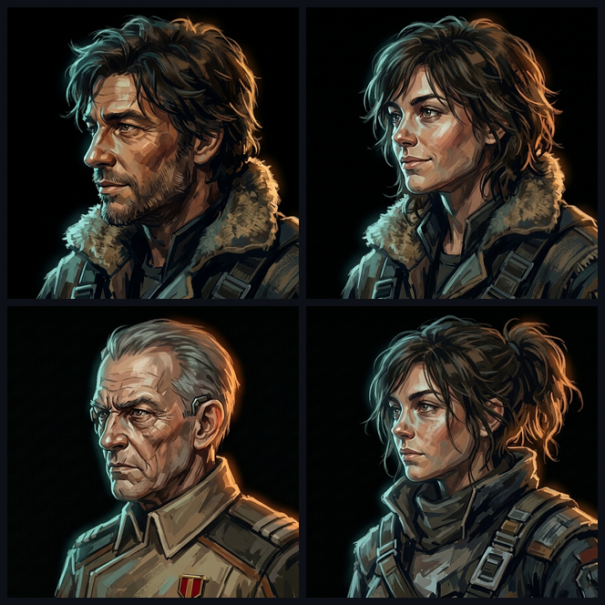

# The Other Captain

A comedy questline for **Starsector 0.98a**: someone has been evading taxes under your name.

Follow the paper trail of John Starsector (or Jane, if you play a woman), a walking disaster with
good papers, from a Hegemony customs stop through the Foundling Wheel orphanage and its charity gala
to a reckoning, while a Hegemony warrant keeps growing. How you handle the tax collector, the kids at
the Wheel and the gala decides how it ends.

> **Work in progress, being playtested.** The story is complete and exported, so this folder is a
> mod you can try: copy it into `Starsector/mods/` (it needs the two mods below). It hasn't been
> played through in game yet, so expect rough edges. A release zip comes once it has.

## Needs

- **[SagaLib](https://github.com/LastAi/Starsector-SagaLib/releases) 1.4** or newer
- **[Generic Image Mod](https://github.com/LastAi/Starsector-GenericImageMod)** (two of the gala's pictures)

## Open it in Saga Forge

Made with **[Saga Forge](https://github.com/LastAi/Starsector-SagaForge)** 1.3. Put this folder in
your Saga Forge workspace (or `Starsector/mods/`), pick **The Other Captain** as the active mod, and
everything is there: the quest chart (Quests), people, encounters, the Hegemony Warrant crisis bar
(Saga › Progress) and the pictures. Play mode runs the whole story in the editor; **Export** writes
the game files.

## AI use disclaimer

Some or all text and art in this mod were created using AI tools:

- **Art** (portraits, illustrations, icons): generated by the author with AI image tools, then picked,
  cropped and resized in Saga Forge.
- **Text**: the story, characters and acts were designed by the author, who wrote the opening acts.
  Later acts, the evidence hand-in and some dialog were drafted with **Claude** (Anthropic) from the
  author's outline, then reviewed and edited by the author.
- **Code**: none. The mod is data: Saga Forge's project files and its export.

The author directed and reviewed all of it and tested the story in Saga Forge's Play mode.

## Licenses

- Text, story and the Saga Forge project: **MIT** (`LICENSE`).
- Pictures (`graphics/`, `sagaforge/originals/`): **CC BY 4.0** (`LICENSE-ART`). Credit: LastAi.
